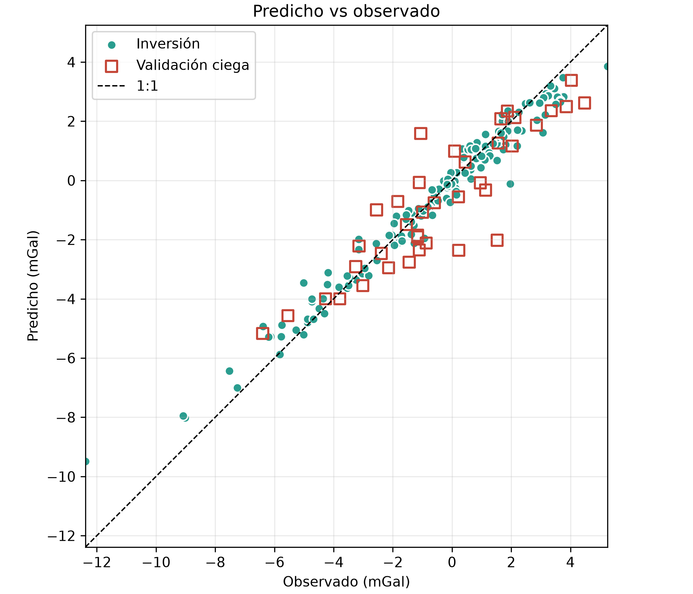
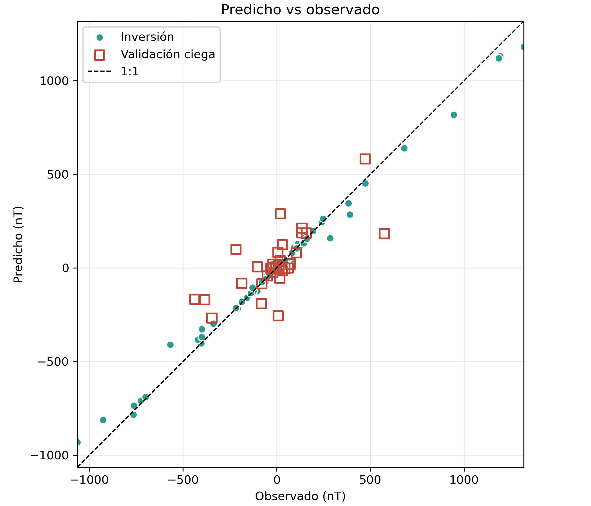
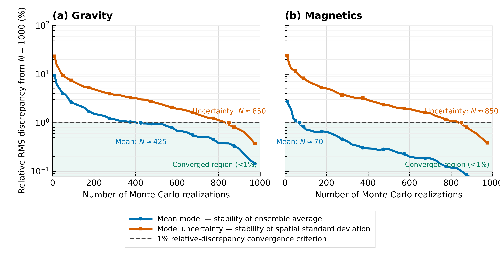
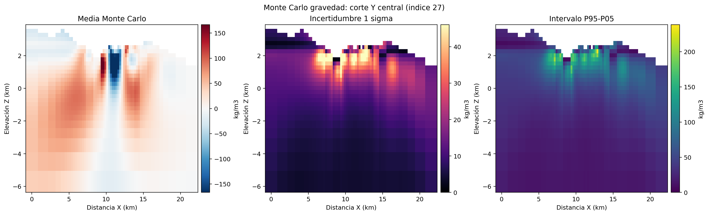
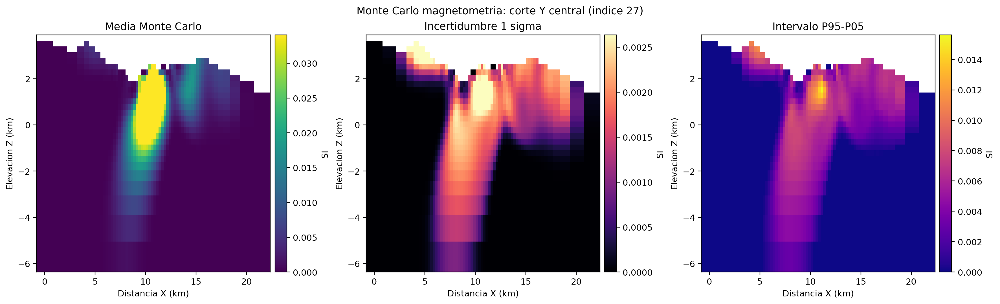

<div align="center">

# CERRO MACHÍN
### Independent 3-D Potential-Field Imaging

**Gravity · Magnetic Susceptibility · Monte Carlo Model Variability**


*Complementary physical properties. Independent inverse problems. Explicit model variability.*

</div>

---

## Data availability

The data can be requested from the lead author. Field observations and topography are private and are not distributed here, including copies previously embedded in output archives. Notebook outputs have been cleared. Re-running inversions requires the original input data and common mesh geometry from the lead author. Published figures and derived models remain available.

The complete original archive, its history, and ensemble releases are preserved in a separate private repository. This public repository starts with a new history to keep input data private.

## Scientific context

This repository supports the **gravity and magnetic components** of the manuscript *3D Multiphysics Imaging of Cerro Machin Volcano From Gravity, Magnetic, and Magnetotelluric Data*, by Ana Mantilla-Dulcey, Cristina Lizcano, Kevin Tarazona, and Henry Arguello.

Cerro Machín is an active dacitic volcano in Colombia's Central Cordillera. Gravity constrains subsurface **density contrast**; magnetics constrains **effective magnetic susceptibility**, under an induced-magnetization assumption. Their independent 3-D models provide complementary evidence for the volcanic and hydrothermal architecture. Monte Carlo data perturbations quantify model variability conditional on the adopted mesh, uncertainties, and inversion settings; they do not establish a unique geological interpretation or a Bayesian posterior.

The collection is curated from [MANTLE-3D](https://github.com/Anagabrielamantilla/MANTLE-3D/tree/ae063f661a7be0b379d0103e543f1d9f4dd5d9d9), with related Monte Carlo products recovered from the author's local research archive. It includes the shared potential-field mesh, independent inversion notebooks and modules, figures, inversion outputs, and Monte Carlo outputs. Magnetotelluric files, joint inversions, neural fields, synthetic benchmarks, and PCA integrations are outside this repository's scope.

## At a glance

| Archived quantity | Gravity | Magnetics |
| :--- | :--- | :--- |
| Observations | 187 stations | 165 stations |
| Inversion / withheld validation | 149 / 38 | 132 / 33 |
| Observable | Residual Bouguer anomaly, mGal | Total-field magnetic anomaly, nT |
| Recovered property | Density contrast | Effective susceptibility, SI |
| Archived uncertainty floor | 0.70 mGal | 26.366116 nT |
| Archived Monte Carlo realizations | **1,000** | **1,000** |
| Monte Carlo seed | `20260906` | `20260906` |

The common tensor mesh contains **60 × 54 × 28 cells**, with **71,390 active cells** below topography. Coordinates use **MAGNA-SIRGAS 2018 / Origen-Nacional, EPSG:9377**, with positive elevation upward. The exact mesh and active mask are versioned with SHA-256 checksums. The vertical datum remains unconfirmed in the source metadata.

## Scientific figures

### Independent inversion: observed versus predicted

<table>
<tr><th>Gravity</th><th>Magnetics</th></tr>
<tr>
<td></td>
<td></td>
</tr>
</table>

### Monte Carlo variability and ensemble convergence



*Archived convergence diagnostic relative to the 1,000-realization ensemble. See the accompanying statistics and the methodological caveat below.*

<table>
<tr><th>Density variability</th><th>Susceptibility variability</th></tr>
<tr>
<td></td>
<td></td>
</tr>
</table>

Editable SVG figures are retained alongside raster products and in [`figures/`](figures/).

## Repository map

```text
CERRO-MACHIN-POTENTIAL-FIELDS/
├── configs/                 # Potential-field inputs and inversion settings
├── data/
│   └── README.txt          # Input data available from the lead author
├── notebooks/
│   ├── 01_gravity_inversion.ipynb
│   └── 02_magnetic_inversion.ipynb
├── src/mantle3d/            # Independent solvers and shared geometry utilities
├── scripts/                # Gravity/magnetic Monte Carlo, retrieval, validation
├── figures/                # Related potential-field SVG figures
├── outputs/
│   ├── common_mesh/        # Exact tensor mesh, topography, active mask, hashes
│   ├── gravity/            # Archived inversion model and predictions
│   ├── magnetics/          # Archived inversion model and predictions
│   ├── figures/            # Independent inversion comparison figures
│   └── monte_carlo/        # Statistics, figures, summaries, and per-run logs
├── docs/                   # Provenance, integrity manifest, reproduction notes
└── vtk/                    # VTK models added by the author
```

`vtk/` contains models subsequently uploaded by the author (`MT.vtk`, `Magnetic.vtk`, and `gravity.vtk`). The independent inversion scripts and Monte Carlo workflows remain restricted to gravity and magnetics.

## Explore the archived outputs

### Install the field-only environment

```bash
conda env create -f environment.yml
conda activate cerro-machin-potential-fields
python scripts/verify_archive.py
jupyter lab
```

Alternatively, with Python 3.11 or later:

```bash
python -m venv .venv
source .venv/bin/activate
pip install -e '.[geophysics,montecarlo,dev]'
python scripts/verify_archive.py
```

Open the gravity notebook first and the magnetic notebook second. Running them performs **new smooth inversions** and overwrites their output files. Read the reproduction notes before interpreting a rerun as a reproduction of the manuscript's sparse gravity solution.

### Run gravity Monte Carlo

```bash
python scripts/run_gravity_monte_carlo.py --n 1000 --seed 20260906
```

The gravity runner perturbs observations in field-convention mGal, preserves the original training/validation split and data weights, and converts recovered densities from g/cm³ to kg/m³. It writes the full ensemble, mean, sample standard deviation, percentiles, NPY/VTK volumes, figures, metrics, and per-run logs into **`outputs/monte_carlo/gravity_new/`**. Use `--output-dir` to select another empty directory. Add `--skip-vtk` to run without pyvista and omit VTK export. A nonempty destination is rejected to protect archived products. The current smooth solver and configured bounds are recorded in the run summary; this new driver is not the missing historical IRLS implementation.

### Complete Monte Carlo ensembles

The original compressed ensembles exceed GitHub's 100 MB per-file Git limit: approximately **553 MB for gravity** and **258 MB for magnetics**. Both unmodified NPZ files are attached to the private archive's [`data-v1` release](https://github.com/Anagabrielamantilla/CERRO-MACHIN-POTENTIAL-FIELDS-PRIVATE/releases/tag/data-v1). Compact NPZ files in the Git tree preserve every non-ensemble array from these originals, including means, standard deviations, percentiles, geometry, seed, realization count, and metrics.

With GitHub CLI authenticated to an account that can access the private archive:

```bash
python scripts/download_ensembles.py
```

The script restores each original file under `outputs/monte_carlo/<method>/` and checks its SHA-256 digest against [`docs/ensemble_assets.json`](docs/ensemble_assets.json). Full realization arrays are named `density_models_kgm3` and `susceptibility_models_si`. The compact files are named `gravity_monte_carlo_statistics.npz` and `magnetic_monte_carlo_statistics.npz`.

### Physical units

Gravity inversion arrays ending in `_gcc` are in **g/cm³**: multiply by **1,000** to obtain kg/m³. Gravity Monte Carlo arrays already use **kg/m³**. Magnetic inversion and Monte Carlo susceptibility arrays use **SI**. Observation and prediction arrays explicitly encode mGal or nT in their names. Inactive cells may contain NaN; use the provided `active` mask. The saved 3-D models use Fortran ordering when reshaped from cell vectors.

## Reproduction status and manuscript alignment

This is an archive of available research products, with documented limits on exact regeneration:

- **Realization count:** both recovered Monte Carlo archives contain 1,000 realizations. The supplied manuscript's Fig. 5 states 2,000 gravity realizations. No 2,000-realization ensemble has been substituted or generated.
- **Gravity algorithm:** the current source implementation uses smooth `WeightedLeastSquares` regularization and density bounds of ±1 g/cm³. The manuscript and local gravity Monte Carlo records describe sparse IRLS with `[0, 0.5, 0.5, 0.5]` norms and ±500 kg/m³ bounds. The historical gravity Monte Carlo driver was not found in MANTLE-3D; exact regeneration requires the matching historical implementation.
- **Magnetic Monte Carlo:** the source script calls an `observed_override` interface absent from the source solver. This repository restores that optional, validated interface. The existing seed and perturbation logic are preserved. New executions have not been claimed to reproduce the archived ensemble bit for bit.
- **Convergence figure:** the archived plotting code used a population running standard deviation and compared it to the final sample standard deviation. The figure is retained as an archived diagnostic; a strict convergence reanalysis should use consistent variance normalization.
- **Portable geometry:** the archived mesh is loaded and verified rather than rebuilt because a machine-specific DEM path changed. Configuration paths now reference the privately supplied topography table. Historical DEM provenance remains recorded in the source mesh manifest.

Further details and the precise scope of edits are in [`docs/REPRODUCIBILITY.md`](docs/REPRODUCIBILITY.md). Original source checksums are recorded in [`docs/provenance.json`](docs/provenance.json); checksums for the delivered collection are in [`docs/archive_manifest.json`](docs/archive_manifest.json).

## Attribution and research use

**Associated manuscript**  
Ana Mantilla-Dulcey, Cristina Lizcano, Kevin Tarazona, and Henry Arguello. *3D Multiphysics Imaging of Cerro Machin Volcano From Gravity, Magnetic, and Magnetotelluric Data*. Manuscript supplied by the author; publication metadata and DOI have not been established in this archive.

**Computational framework**  
Cockett, R., Kang, S., Heagy, L. J., Pidlisecky, A., & Oldenburg, D. W. (2015). SimPEG: An open source framework for simulation and gradient based parameter estimation in geophysical applications. *Computers & Geosciences*, 85, 142–154.

For traceable use, record the repository commit, the `data-v1` asset checksums, the model units, and the method-specific settings. This public collection does not add a new license or infer redistribution rights for source field data.

---

<div align="center">
<sub>Cerro Machín · Central Cordillera, Colombia · Independent potential-field research archive</sub>
</div>
